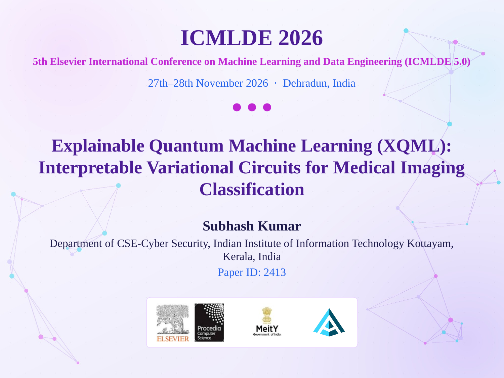
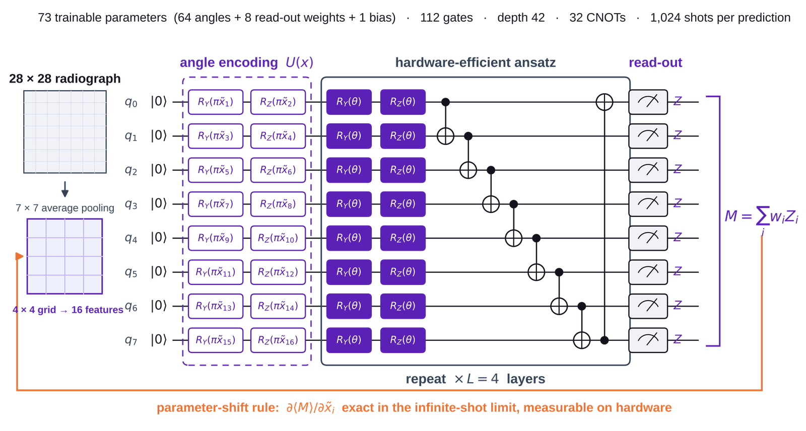
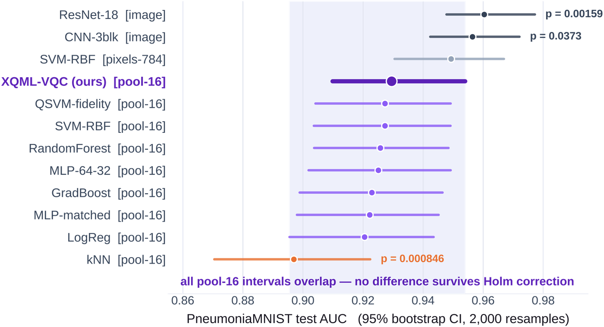

<div align="center">


# Explainable Quantum Machine Learning (XQML)

### Interpretable Variational Circuits for Medical Imaging Classification


**Subhash Kumar**
Department of CSE - Cyber Security, Indian Institute of Information Technology Kottayam, Kerala 686635, India
[subhashkumar24cs@gmail.com](mailto:subhashkumar24cs@gmail.com)



</div>

---

## Overview

Variational quantum circuits are proposed for medical imaging on the grounds that they are compact and, being small, somehow more transparent than deep networks. This work tests both claims under controls that most published comparisons omit.

A hardware-efficient variational classifier with **73 trainable parameters** is benchmarked against **20 classical models** on two MedMNIST v2 tasks under **three matched input representations**, with five seeds, bootstrap confidence intervals for every model, DeLong tests on paired ROC curves and Holm-Bonferroni correction. Its explanations come from the parameter-shift rule, so they are an identity of the model rather than a surrogate fitted afterwards, and they are evaluated rather than assumed.

**The headline is a null result, reported as one.** On matched inputs the circuit neither beats nor is beaten by any classical model. What it does offer is parameter efficiency with a verifiable explanation, paid for in measurement rather than parameters.

<div align="center">

</div>

## Key results

| | PneumoniaMNIST | BreastMNIST |
|---|---|---|
| XQML-VQC (ours), 73 params | **AUC 0.9295 ± 0.0045**, CI [0.910, 0.954] | AUC 0.7770 ± 0.0087 |
| Best matched baseline (pool-16) | AUC 0.9273, not significantly different | AUC 0.8014 |
| ResNet-18, 11.2 M params | AUC 0.9604 (p = 0.0016) | AUC 0.8660 |

- No pool-16 baseline differs after Holm correction, including a parameter-matched perceptron (p = 0.46) and a fidelity-kernel QSVM (p = 0.18).
- Shift-rule attributions beat their random control by **0.119** on region deletion and **0.135** on insertion; Grad-CAM by 0.026 and -0.029.
- Barren plateau: ring decay exponent steepens from **-0.244** at L = 1 to **-0.823** at L = 8, while the unentangled ansatz stays near -0.277.
- Cost: **1,024 circuit executions** per prediction against 73 multiply-accumulate operations for the equivalent classical model.

<div align="center">

</div>

## Repository contents

| Path | Description |
|---|---|
| `qsim.py` | Batched state-vector simulator in PyTorch: gate fusion, CNOT ring folded into one basis permutation, parameter-shift gradients |
| `validate_sim.py` | Independent verification against **PennyLane 0.45** on six quantities; largest deviation 2.4 × 10⁻¹⁵ |
| `data.py`, `config.py` | MedMNIST v2 loading, pooling and PCA front-ends, reproducible splits |
| `train_vqc.py`, `rerun_main.py` | Training loop and the five-seed runs behind every reported number |
| `bl_runner.py` | All 20 classical baselines at pool-16 / PCA-8 / pixels-784 / image |
| `explain.py`, `region_faith.py` | Parameter-shift attribution, deletion and insertion curves, region-level faithfulness |
| `plateau_ci.py`, `resources.py` | Barren-plateau scan with bootstrap intervals; gate, depth and shot accounting |
| `make_tables.py`, `figures.py` | Tables and figures as they appear in the paper |
| `paper/` | Camera-ready manuscript, added once published |

## Quantum stack

- **Simulation.** All reported results come from the project's own batched state-vector simulator, written in PyTorch and running on CPU. It is noiseless, with finite-shot sampling and heterogeneous read-out noise applied at the measurement stage.
- **Verification.** Correctness is established against **PennyLane 0.45** across the state vector, Pauli-Z expectations, input and parameter gradients, PennyLane's own shift-rule gradients and the von Neumann entropy. Run `validate_sim.py` before trusting any result.
- **Hardware (roadmap).** Execution of the selected circuit on **IBM Quantum** devices through Qiskit, with dynamical decoupling and measurement-error mitigation, followed by a repeat of the attribution analysis. This is stated as future work in the paper and is not part of the reported results.

## Reproducing

```bash
pip install -r requirements.txt
python validate_sim.py       # simulator vs PennyLane, expect ~1e-15
python rerun_main.py         # five seeds per dataset
python bl_runner.py          # classical baselines
python make_tables.py        # rebuild every table in the paper
```

Set `XQML_PAPER_SPLIT=1` to reproduce the manuscript's 468-image BreastMNIST training split, which differs from the official 546 because the validation split had to be reconstructed.

## Access

This repository is maintained as a **restricted research archive**. Code, trained weights and result files are shared **on request** for review, replication or collaboration. Please email [subhashkumar24cs@gmail.com](mailto:subhashkumar24cs@gmail.com) with your name, affiliation and intended use.

The camera-ready paper will be added here once it appears in Procedia Computer Science.

## Citation

```bibtex
@inproceedings{kumar2026xqml,
  author    = {Subhash Kumar},
  title     = {Explainable Quantum Machine Learning {(XQML)}: Interpretable
               Variational Circuits for Medical Imaging Classification},
  booktitle = {Proceedings of the 5th International Conference on Machine
               Learning and Data Engineering (ICMLDE 2026)},
  series    = {Procedia Computer Science},
  publisher = {Elsevier},
  year      = {2026},
  note      = {Paper ID 2413}
}
```

## Data and ethics

Both datasets are public, fully de-identified components of MedMNIST v2: PneumoniaMNIST (5,856 paediatric chest radiographs) and BreastMNIST (780 breast ultrasound images). No ethical approval or informed consent was required.

---

<div align="center">
<sub>ICMLDE 2026 · Dehradun, India · Paper ID 2413 · IIIT Kottayam</sub>
</div>
